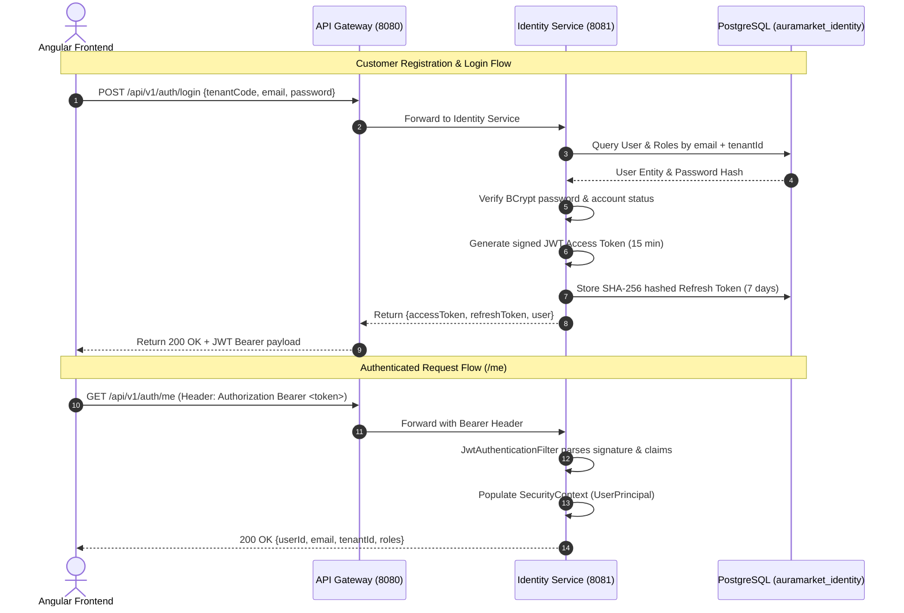

# Identity Service Architecture & Security Specifications

## 1. Domain Ownership & Boundaries

The **Identity Service** is the central authentication and authorization engine for the AuraMarket platform. It owns:
- Users (`users` table)
- Normalized Role assignments (`roles`, `user_roles` tables)
- Password Credentials (`password_hash` with BCrypt)
- Refresh Token Sessions (`refresh_tokens` table)
- Account Statuses (`ACTIVE`, `INACTIVE`, `LOCKED`, `PENDING_VERIFICATION`, `DELETED`)
- OAuth Provider References (`provider`, `provider_user_id`)
- Tenant Association (`tenant_id` as logical reference)

### Strict Data Isolation Rules
1. **NO Cross-Database Queries**: Downstream services (Catalog, Order, Seller) cannot access `auramarket_identity` directly.
2. **NO Shared Entities**: Downstream services resolve user credentials using JWT claim payloads or REST API calls via Gateway.
3. **Single Source of Truth**: PostgreSQL (`auramarket_identity`) is the single authoritative source of truth for authentication data. Redis is reserved strictly for ephemeral rates or session deny-lists.

---

## 2. Architecture & Flow Diagram



---

## 3. JWT Claims Specification

Access tokens are stateless, signed JWT tokens issued with HMAC-SHA256 (or RSA):

```json
{
  "sub": "e4a8f9c1-4b2a-43d9-9f7a-8b1c2d3e4f5a",
  "iss": "auramarket-identity",
  "aud": ["auramarket-api"],
  "iat": 1727275740,
  "exp": 1727276640,
  "jti": "f8a7b6c5-3d2a-41b9-9f8a-1c2d3e4f5a6b",
  "email": "customer@example.com",
  "tenantId": "AURA_AYURVEDA",
  "roles": [
    "CUSTOMER"
  ]
}
```

### Claim Definitions
- `sub`: User's stable UUID.
- `tenantId`: Scoped multi-tenant code (e.g., `AURA_AYURVEDA`, `STYLE_HUB`).
- `roles`: Assigned RBAC role codes (`CUSTOMER`, `SELLER`, `DOCTOR`, `ADMIN`).

---

## 4. Refresh Token Security & Token Rotation

Refresh tokens are stored securely in `refresh_tokens`:

1. **SHA-256 Hash Storage**: Raw refresh token strings are never saved in plain text in PostgreSQL. Only the Base64 SHA-256 digest is stored.
2. **Automatic Token Rotation**: Upon invoking `/api/v1/auth/refresh`, the presented token is verified for expiration and revocation. Once validated, the existing token is marked `revoked_at = now()`, and a fresh access token + new refresh token pair is returned to the client.
3. **Server-Side Logout**: `/api/v1/auth/logout` revokes the refresh token session in PostgreSQL, preventing future token renewals.

---

## 5. Multi-Tenant Authorization Security

- Frontend requests cannot override `tenantId`. The `tenantId` extracted from the verified JWT claim governs backend authorization.
- Downstream microservices parse the signed JWT or `CurrentUser` context (`userId`, `tenantId`, `roles`) to enforce tenant data isolation.

---

## 6. Google OAuth2 Integration Extension Strategy

- **Backend Verification**: `GoogleTokenVerifierService` verifies Google ID Token claims (`sub`, `email`).
- **Provider Linkage**: Provider set to `GOOGLE`, `providerUserId` set to Google's stable `sub` claim.
- **Security Rule**: Google authentication automatically assigns **`CUSTOMER`** role only. Merchants (`SELLER`) and Administrators (`ADMIN`) cannot be self-provisioned via Google OAuth.

---

## 7. Future Kafka Domain Event Contract

When a user completes registration, `identity-service` can publish `user.registered.v1`:

```json
{
  "eventId": "b9f2c1a8-3e4d-5c6b-7a8f-9e0d1c2b3a4f",
  "eventType": "user.registered.v1",
  "eventVersion": "1.0",
  "occurredAt": "2026-09-25T20:09:00Z",
  "correlationId": "corr-12345",
  "tenantId": "AURA_AYURVEDA",
  "producer": "identity-service",
  "payload": {
    "userId": "e4a8f9c1-4b2a-43d9-9f7a-8b1c2d3e4f5a",
    "email": "customer@example.com",
    "roles": ["CUSTOMER"]
  }
}
```
